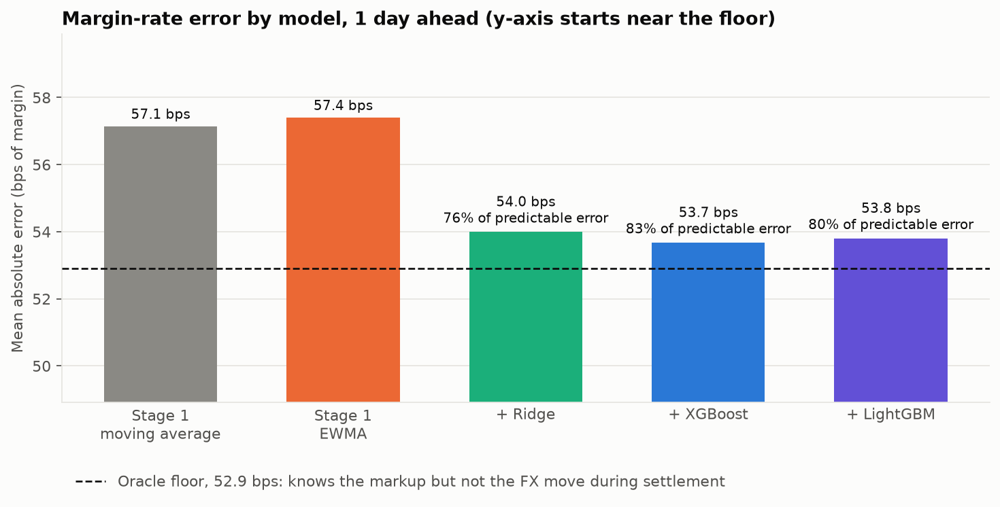
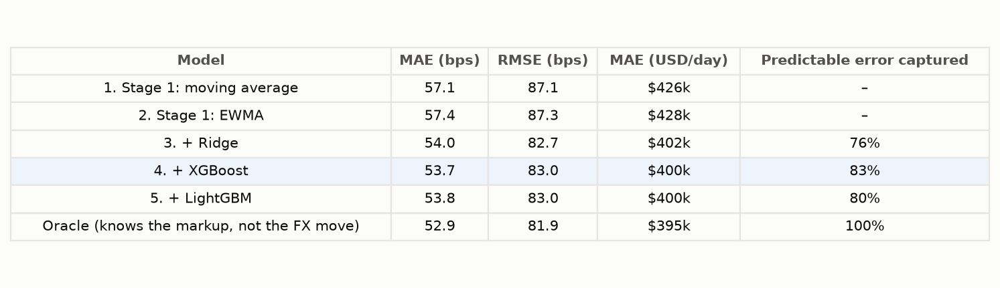
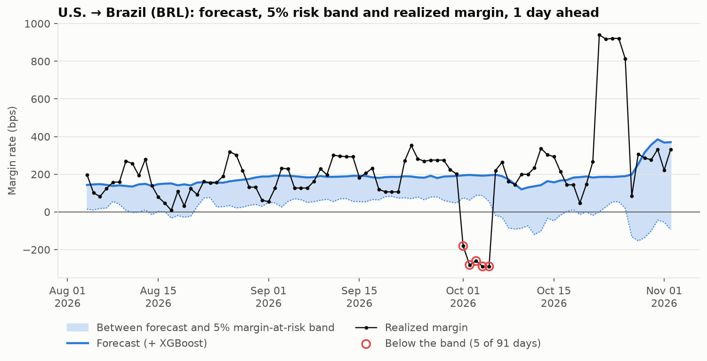
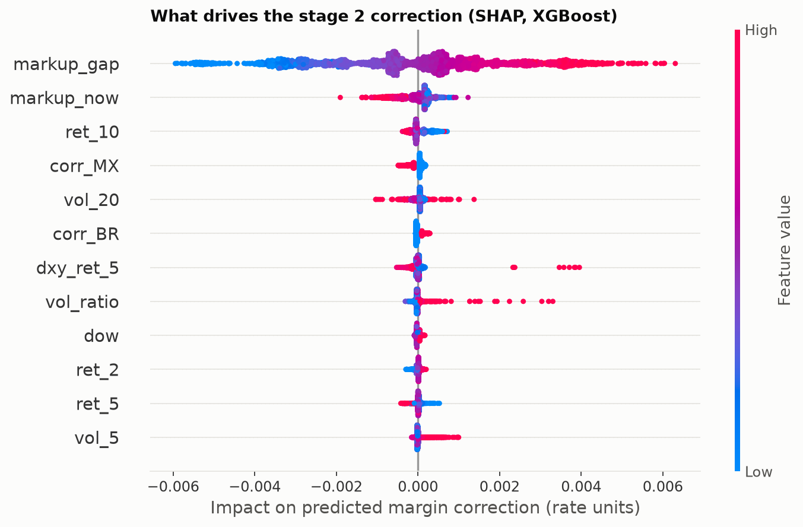

# Two-stage FX margin forecaster

A money-transfer business quotes each customer yesterday's market exchange rate minus a markup,
then buys the currency a day or two later at whatever the market rate is by then. If the currency
moves against it in between, the margin shrinks or even turns negative. This project forecasts
each corridor's daily margin and its **margin at risk**, using two stages: a trend first, then
machine learning on what the trend misses.

📄 **[Methodology](METHODOLOGY.md)**: how the data is built, how each stage is estimated and
tested, with formulas. Also as a [notebook](notebooks/methodology.ipynb). For a guided tour with
charts, see the [walkthrough](notebooks/walkthrough.ipynb).

## Headline result

Over two years of walk-forward forecasts (November 2024 to November 2026), stage 2 cuts the
1-day-ahead margin error **from 57.4 to 53.7 basis points**. That's 83% of the error that can be
predicted at all.

The remaining 52.9 bps is the currency's move during settlement. FX rates behave close to a
random walk, so no model can forecast that part. Instead, it's measured by the **margin-at-risk
band**, which is breached on **5.6% of days** against a 5% target.



## Data

| Part | Source | Details |
|---|---|---|
| **Market FX rates** | real, [FRED](https://fred.stlouisfed.org/) | Mexican peso (`DEXMXUS`), Indian rupee (`DEXINUS`), Brazilian real (`DEXBZUS`) and the broad dollar index (`DTWEXBGS`), daily, 2016-01-01 to 2026-11-06; non-trading days forward-filled |
| **Pricing policy** | **simulated** | markup of 0.5–2%: a base per currency, plus a reaction to recent FX volatility, a slow drift and occasional pricing reviews |
| **Settlement** | **simulated** | next business day (T+1), or T+2 for 30% of trades |
| **Volumes** | **simulated** | the [Project 2](https://github.com/marlondocouto2/cash-flow-forecaster) generator: trend, weekday, paydays, holidays and spikes; Brazil added as a corridor |

The FRED data is saved in [`data/fred/`](data/fred), about 215 KB, so the project runs offline.
Everything about the business itself is simulated; see [data/README.md](data/README.md).

## Approach

- **Margin mechanics:**
  - **Customer rate:** yesterday's market rate × (1 − markup).
  - **Realized margin rate:** 1 − customer rate ÷ settlement rate.
  - **USD margin:** volume × margin rate.
- **Stage 1, trend:** an EWMA (exponentially weighted moving average) of past margins, with a
  28-day moving average as a comparison. It only uses margins that had certainly settled, at least
  4 days old.
- **Stage 2, residual models:** Ridge, XGBoost and LightGBM learn stage 1's error from features
  known at the forecast date:
  - lagged FX returns (1, 2, 5 and 10 days);
  - 5- and 20-day volatility, and their ratio;
  - the broad dollar index;
  - today's markup, and its gap to the stage 1 forecast;
  - recent stage 1 errors;
  - calendar flags.
- **Tuning:** Optuna with time-ordered cross-validation, run only on data from before the test
  period. Trials run in parallel.
- **Margin at risk:** LightGBM quantile regression for the 5th percentile, with conformal
  calibration on the most recent 180 days of training data as a safeguard, so the band is breached
  about 5% of the time.
- **Explainability:** SHAP values show what drives the stage 2 correction.

## Evaluation

**Walk-forward test:**

- **Test period:** the last 2 years, at horizons of 1 and 5 days, for 3 corridors.
- **Refits:** stage 1 updates daily. Stage 2 is refit every 30 days, on margins settled before
  the refit date.
- **Oracle reference:** it knows each day's markup exactly but not the FX move. It marks the best
  error any model could achieve.

**Results, 1 day ahead** (all horizons are in [`reports/results.csv`](reports/results.csv)):



- **The predictable part is small:** about 4.5 bps out of 57. The rest is the currency's move
  during settlement.
- **Stage 2 captures most of it:** XGBoost captures 83%, LightGBM 80% and Ridge 76%.
- **5 days ahead,** LightGBM edges ahead: LightGBM 71%, XGBoost 68%, Ridge 64%.
- **In dollars:** the average absolute error falls from \$428k to \$400k per corridor-day.

**Margin at risk.** The 5% band is breached on 5.6% of days at both horizons:

| Corridor | Breached | Average band width |
|---|---|---|
| Mexico | 5.1% | 118 bps below the forecast |
| India | 5.6% | 70 bps below the forecast |
| Brazil | 6.2% | 133 bps below the forecast |

The chart below shows the most volatile three months in the test period. These are **real**
Brazilian real moves:

- **5 October 2026:** a 4.5% rally pushed margins on unsettled trades below zero. These are the
  red-circled breaches.
- **26 October 2026:** an 8% sell-off produced a windfall on unsettled trades.



**What drives the correction.** The gap between today's markup and the stage 1 forecast dominates.
Today's markup, the 10-day FX return, volatility and the corridor add smaller, non-linear
adjustments; that's where the tree models beat Ridge.



## How to run

```bash
python3 -m venv .venv && source .venv/bin/activate
```

```bash
pip install -r requirements.txt
```

```bash
python scripts/run_pipeline.py && pytest
```

The pipeline takes about 25 seconds. It writes the result tables, every forecast
(`reports/backtest_forecasts.csv.gz`), the SHAP importance and the charts.

**Options:**

- **`--tune`:** re-runs the Optuna search, about 35 seconds.
- **`--refresh`:** re-downloads the FRED data.

**On a Mac,** XGBoost and LightGBM need OpenMP: run `brew install libomp` first.

**Tests (6):**

- **No leakage:** no feature uses data after the forecast date, and forecasts don't change when
  future market data is altered.
- **Results:** stage 2 beats stage 1 on MAE at both horizons, and the risk band is breached on
  3–7% of days.
- **Mechanics:** the margin formula and markup bounds hold, and the oracle is a true floor.

## What I'd do next

- **Hedging:** model what a forward or same-day hedge would cost against the margin it protects.
- **Pricing:** use the risk band to widen the markup when volatility rises, and simulate the effect
  on volume.
- **Real volumes:** connect to the volume forecasts from Project 2 instead of actual volumes, so
  USD errors include volume error.
- **Cloud tuning:** run the same Optuna search as a managed tuning job (for example SageMaker), as
  described in [`tuning.py`](src/fx_margin/tuning.py).
